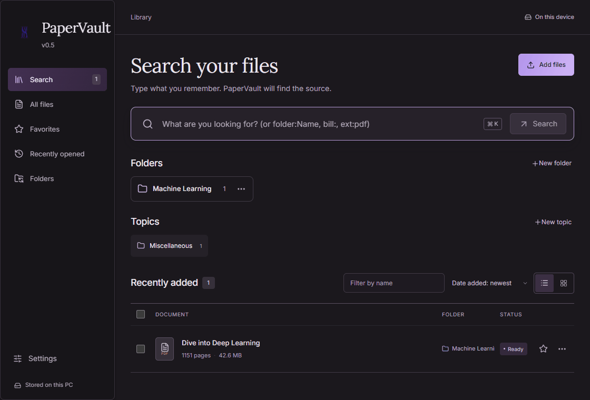

# PaperVault

> **I'm Yash, and I'm looking for work.** I built PaperVault because I wanted to find things on my PC even when I couldn't remember the filename. If this project makes you think I'd be a good fit for your team, I'd love to hear from you. I'm open to jobs, internships, research roles, and collaborations in AI or software. A referral or an introduction would mean a lot, too.
>
> **Email me at [yashharwani321@gmail.com](mailto:yashharwani321@gmail.com)** · [LinkedIn](https://www.linkedin.com/in/yash-harwani/) · [GitHub](https://github.com/yashharwani18)

Describe it. Find it across your entire PC.

Search the documents, notes, code, spreadsheets, and books on your computer by what they mean, with local neural embeddings.

[Download for Windows (.exe)](https://github.com/yashharwani18/PaperVault/releases/latest) · [Download Android preview (.apk)](https://github.com/yashharwani18/PaperVault/releases/download/android-v0.5.0/PaperVault-Android-v0.5.0.apk) · [Run from Source](#run-from-source)

**Android preview:** I don’t recommend it for everyday use yet. Initial indexing can take a long time on a phone, especially with a large library. [Android install instructions](#android-preview)



Demo source: [*Dive into Deep Learning*, §5.4](https://en.d2l.ai/chapter_multilayer-perceptrons/numerical-stability-and-init.html) by Aston Zhang, Zachary C. Lipton, Mu Li, and Alexander J. Smola ([CC BY-SA 4.0](https://github.com/d2l-ai/d2l-en/blob/master/LICENSE)). The recording shows a highlighted excerpt.

---

PaperVault brings neural document search to your entire PC. It runs [EmbeddingGemma 2](https://huggingface.co/google/embeddinggemma-2), the open multimodal model from Google DeepMind, directly on your graphics card or processor. It puts documents, notes, spreadsheets, code, and books into one shared semantic space: a legal paragraph about lease breaks lands next to "how do I cancel my contract", and a function handling network timeouts lands next to "where do we retry dropped connections".

Unlike tools that force you to manually curate folders or drag-and-drop files one by one, PaperVault discovers documents across your whole computer in the background. Then describe what you're looking for, in your own words, and it finds the exact source—opening it in a built-in dark-mode viewing studio with the matching passage glowing on the page.

---

## What you can find

* **"the clause about termination notice in the lease"** jumps straight to page 14 of the PDF agreement
* **"annual recurring revenue 2025"** highlights the table row in your `.csv` or `.xlsx` spreadsheet
* **"exponential backoff retry loop"** opens the Python or TypeScript file at the exact function definition
* **"receipt for laptop purchase in September"** finds the invoice and extracts the total amount
* **"treatment of acute asthma exacerbation"** surfaces the relevant section in a 600-page medical textbook
* **Cross-language search:** a query in English can find a note written in Hindi, Spanish, French, German, or any of the 100+ languages the model understands, and vice versa

**Exact words count too.** Invoice numbers, UUIDs, function signatures, error codes, and tax IDs are matched verbatim using SQLite FTS5, so search combines deep semantic understanding with exact lexical precision.

---

## Whole-PC discovery — zero folder sorting

* **One-Click Machine Scan:** On first launch, select **"Yes, scan this computer"**. PaperVault automatically crawls your local drives (`C:\`, `D:\`) in the background. You never have to manually remember which folder a document was saved in.
* **Safe by Design:** Automatically isolates user documents while skipping Windows system directories, application caches, `.git`, `.ssh`, temporary folders, and binary blobs.
* **Non-Destructive & In-Place:** Your files are never moved, altered, duplicated, or uploaded. PaperVault creates an index pointing to where files naturally live on disk.
* **Background Sync:** A low-priority background watcher checks for newly downloaded, modified, or saved files and keeps your search index fresh.

---

## Built-In "Everything Viewer"

Search doesn't kick you out to external programs or leave you guessing where a match was found. Clicking any result opens an integrated dark-mode viewing studio directly inside the app:

| File Type | Viewer Experience |
| :--- | :--- |
| **PDFs & Presentations** | Continuous Mozilla PDF.js canvas that automatically scrolls to the matched page and paints glowing highlights over the target passage |
| **Code Studio** | Full syntax highlighting for Python, TypeScript, JavaScript, Rust, Go, C++, SQL, and YAML with gutter line numbers and one-click copy |
| **Rendered Markdown** | Rich GitHub-style preview for `.md` notes with tables, blockquotes, code fences, and search hit marks |
| **Data Tables** | Interactive, scrollable grid for `.csv` and `.tsv` files with live in-viewer row filtering |
| **Images & Media** | Hardware-accelerated image canvas with zoom and pan controls, plus inline HTML5 audio/video playback |

---

## Private

Nothing you index leaves your computer. 

* **100% Air-Gapped:** Zero cloud calls. No remote API dependencies. Works completely offline without an internet connection.
* **No Telemetry:** PaperVault does not collect analytics, search histories, document text, or machine identifiers.
* **No Account Required:** No login, no signup, no subscriptions.

---

## Using it

| Shortcut | Action |
| :--- | :--- |
| `Ctrl + K` or `/` | Focus search bar from anywhere |
| `↓` `↑` | Move through search results |
| `Enter` | Open the match directly in the built-in Everything Viewer |
| `Ctrl + Enter` | Reveal the original file in Windows Explorer |
| `Ctrl + C` | Copy the file path or matched snippet |
| `Esc` | Close the Everything Viewer or clear search |

PaperVault lives quietly in your system tray on Windows, where you can monitor indexing progress, pause scanning, or open Settings.

---

## What it reads

* **Documents:** PDF (both digital and scanned text), DOCX, ODT, TXT, Markdown, HTML, RTF, LaTeX, and EPUB (up to 5,000 pages per file).
* **Spreadsheets & Data:** CSV, TSV, XLSX, ODS, JSON, and JSONL data tables.
* **Code:** Source files across 30+ programming languages (Python, TypeScript, JavaScript, Rust, Go, C/C++, Java, Kotlin, Swift, Shell, SQL, YAML, etc.), respecting `.gitignore`.
* **Presentations:** PPTX and ODP slide decks, indexed slide by slide including speaker notes.
* **What it never reads:** System files, registry hives, password files, private keys, hidden directories like `.ssh`, browser caches, and cloud-only placeholder files.

---

## How it works

```
your drives ──► local readers (PDF, Code, Office, Sheets) ──► EmbeddingGemma 2 (CUDA / CPU) ──► SQLite vector + FTS5 index
                                                                                                        ▲
your words  ──► query encoder                             ──────────────────────────────────────────────┘
                                                                                                        ▼
                                                                           hybrid RRF ranker (semantic + exact)
                                                                                                        ▼
                                                                           in-app Everything Viewer with glowing passage
```

PaperVault runs EmbeddingGemma 2 locally using PyTorch CUDA on NVIDIA GPUs (falling back cleanly to CPU instructions where no dedicated GPU is available). Every document passage lives in the same 768-dimensional vector space, indexed alongside a full-text SQLite FTS5 table. Reciprocal Rank Fusion (RRF) merges semantic embeddings and exact lexical hits into a single, ranked result list.

---

## Install

### Windows Installer (Recommended)
1. Download `PaperVault-Setup.exe` from [Releases](https://github.com/yashharwani18/PaperVault/releases/latest).
2. Run the installer (installs locally for your user account without requiring administrator rights).
3. Open PaperVault, select **"Yes, scan this computer"**, and let it build your local index in the background.

### Android preview

Download the [PaperVault APK](https://github.com/yashharwani18/PaperVault/releases/download/android-v0.5.0/PaperVault-Android-v0.5.0.apk) on an ARM64 phone running Android 8 or later. Open the downloaded file and allow installation from that source if Android asks. Leave about 3 GB of free space for the installer, app, and bundled models, plus space for your documents. Start with a few PDFs to see how quickly your phone indexes them.

### Run from Source

#### Prerequisites
* Windows 10 or 11 (64-bit)
* Python 3.11 or 3.12
* Node.js 18+ (for frontend development)
* NVIDIA GPU with CUDA 12+ recommended (CPU supported)

```bash
# 1. Clone the repository
git clone https://github.com/yashharwani18/PaperVault.git
cd PaperVault

# 2. Set up Python virtual environment
python -m venv .venv
.venv\Scripts\activate
pip install -r requirements.lock.txt

# 3. Build the frontend
cd frontend
npm install
npm run build
cd ..

# 4. Launch PaperVault
python -m knowledge_library --library "data/library"
```

---

## FAQ

**How is this different from Windows Search?**  
Windows Search finds files primarily by filename, basic metadata, and exact text occurrences. PaperVault understands the conceptual meaning of your query, searches across languages, handles conceptual questions, and opens the result right inside the app with the specific paragraph illuminated on the page.

**Does it really scan my whole PC without me picking folders?**  
Yes. On first launch, you can grant Whole-PC discovery, and PaperVault systematically crawls local drives while automatically filtering out system binaries and junk caches. If you prefer to specify individual folders instead, you can pick custom folders in Settings at any time.

**Will it slow my computer down?**  
No. Background indexing runs at low process priority and throttles automatically during heavy system use. Once the initial pass finishes, PaperVault enters an idle watch mode that consumes virtually zero CPU until files change.

**What hardware do I need?**  
Any modern 64-bit Windows PC. An NVIDIA GPU with 4+ GB VRAM delivers lightning-fast indexing and sub-50ms search queries via CUDA; on systems without an NVIDIA GPU, PaperVault runs seamlessly on the CPU.

---

## Support

PaperVault is free and open source under the **Apache License 2.0**. If PaperVault helps you find what you need and you want to support development, consider giving the repository a star on GitHub!

---

## Thanks & Open Source

* [Google DeepMind EmbeddingGemma 2](https://huggingface.co/google/embeddinggemma-2) (Apache 2.0)
* [Mozilla PDF.js](https://github.com/mozilla/pdf.js) (Apache 2.0)
* [FastAPI](https://fastapi.tiangolo.com/) & [Uvicorn](https://www.uvicorn.org/)
* [SQLite](https://sqlite.org/) with FTS5
* [React](https://react.dev/) & [Vite](https://vitejs.dev/)

---

## License

[Apache License 2.0](LICENSE) © 2026 PaperVault Contributors.
